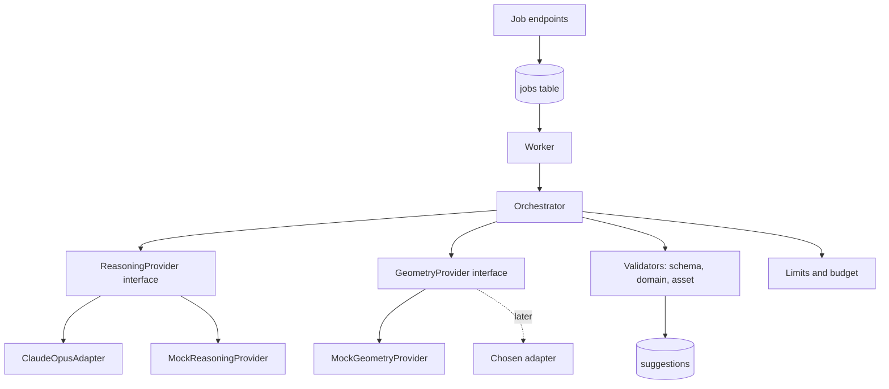

# Design: AI Orchestration

## Overview
`apps/api/ai`. A job queue (PostgreSQL-backed, from the `jobs` module), an `Orchestrator`, two provider interfaces and their adapters, prompt files, suggestion storage and a limits/budget service.



## Interfaces

```ts
interface ReasoningProvider {
  run<T>(task: ReasoningTask<T>, input: ReasoningInput, opts: CallOptions): Promise<ProviderResult<T>>;
}
interface GeometryProvider {
  readonly id: string;
  generate(req: GeometryRequest, opts: CallOptions): Promise<ProviderResult<GeneratedMesh>>;
}
type GeometryRequest = { componentLabel: string; viewImageIds: string[]; targetTriangles: number; units: 'm' };
type GeneratedMesh = { glb: Uint8Array; provenance: { provider: string; version: string; inputImageIds: string[] } };
```

`ReasoningTask` carries a prompt file id and version, the zod output schema and the input builder. Tasks: `identifyComponents`, `analyseRelationships`, `suggestPorts`, `rankFitments`, `suggestAssemblyOrder`. Behaviour recommendations come inside `suggestPorts` and `rankFitments` payloads as advisory fields.

## Suggestion Storage

```
suggestions(id, job_id, playground_id, kind, payload jsonb, ai_confidence numeric,
  validation_status, validation_reasons jsonb,
  review_status default 'proposed', reviewed_by, reviewed_at, edited_payload jsonb,
  source jsonb /* model, prompt_version, input ids */)
```

- Constraint: `review_status` changes only through the `ReviewService` called from authenticated owner endpoints. The orchestrator module has no import of it (checked by a boundary lint rule).
- `apply(suggestionId)` is allowed only when `validation_status` is valid and `review_status` in (`accepted`, `edited`). It re-validates the (edited) payload at apply time.

## Validation Pipeline
`schemaValidate` -> `domainValidate` (uses `domain` assembly validators, the library registry and behaviour registry) -> for assets: `assetValidate` and budget enforcement. Results set `validation_status`. Confidence is not an input to any validator.

## Resilience
- `withRetry(fn, policy)`: exponential backoff with jitter, `Retry-After` support, max attempts and total deadline from config.
- Per-call timeout and per-job deadline via `AbortSignal`.
- Cancellation checks between stages.
- Partial results: each sub-task result is stored independently.

## Limits and Budget
Config defaults (confirm in review): 10 jobs/day/user, 2 concurrent, up to 12 images/job, 10 MB per image after processing, 3 retries, spend budget per user per month and global with 80% alert and hard stop at 100%. Cost estimation from token counts and provider price config. Over-limit returns `429 AI_LIMIT_REACHED` with the reason and reset time.

## Prompts
`apps/api/ai/prompts/<task>/<version>.md` with a header stating that all image and label content is untrusted data, and a strict JSON output instruction. Prompt files are covered by review like code. A golden-file test checks that prompt version ids match the schema versions.

## Privacy and Logging
- Consent record table with version and timestamp, required before job creation.
- Logger redaction: no images, prompts or outputs at info level. Debug-level storage of prompts is off by default.
- Deletion hooks registered with the deletion service from the backend spec.

## Mock Providers
- `MockReasoningProvider`: scripted outputs keyed by fixture name. Failure modes: timeout, 429, 5xx, invalid JSON, schema-invalid, domain-invalid (missing port, cyclic dependencies), refusal, partial.
- `MockGeometryProvider`: fixture GLBs. Failure modes: timeout, error, corrupt file, over-budget, wrong units.

## Open Decision
Real geometry adapter: chosen before spec 14. Evaluation criteria to record: output quality (watertight, reasonable triangles), licence of outputs, data-retention terms, cost per generation, latency, privacy, and whether self-hosting is required.

## Testing
Follows `testing-standards.md` section 5. All provider interactions are mocked. Add boundary-lint tests that the orchestrator cannot import `ReviewService` or the binding creation code.
