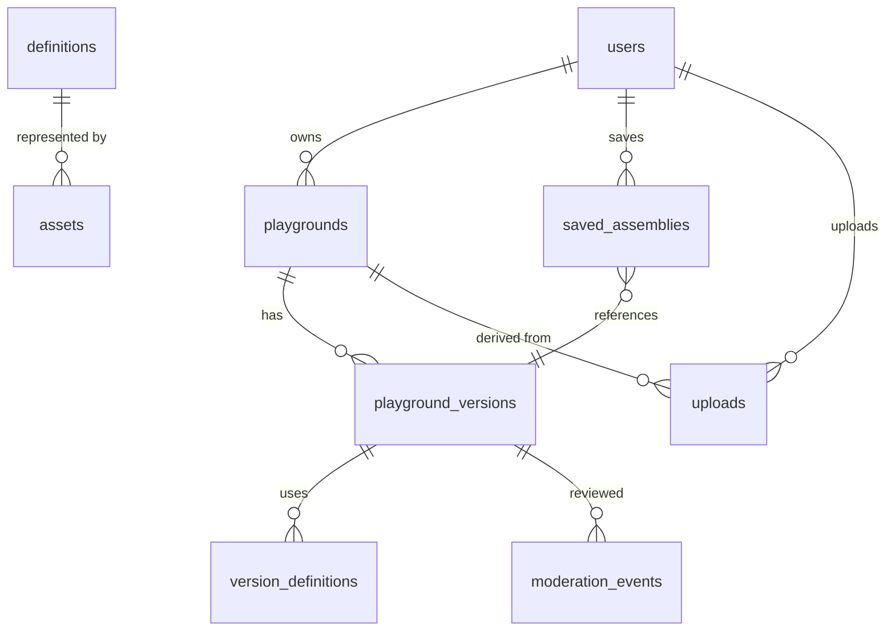

# Design: Backend, Accounts and Persistence

## Overview
`apps/api` on Node/TypeScript with PostgreSQL and S3-compatible storage. Request and response types come from `packages/schema`. Domain and library validators are imported from the shared packages so the client and server agree.

## Modules
`auth`, `users`, `playgrounds`, `definitions`, `assets`, `assemblies`, `uploads`, `moderation`, `jobs` (generic queue used later by AI), `storage`, `db`, `http`.

## Data Model (PostgreSQL)

- `playground_versions.content` is JSONB validated against the `PlaygroundDefinition` schema. `status`, `version`, `published_at` are columns. A unique `(playground_id, version)`.
- Immutability: a database trigger (and the API) rejects updates to rows with `status = 'published'` except for `archived` transitions.
- `definitions` and `assets` have `scope` (`platform` or `creator`), `owner_id`, and metadata JSONB validated by schema. `assets.uri` points to private storage.
- `behaviour_bindings` are inside instance JSON. Server validation inspects them. There is no table of behaviours (they are code).
- `uploads` records owner, status (`quarantined | clean | rejected | deleted`), size, sha256, mime (detected), purpose, and `expires_at`.

## Auth
Decision to confirm in implementation: server-side sessions in PostgreSQL with httpOnly cookies, or short-lived JWT plus refresh. Default recommendation: server-side sessions (simple revocation). Passwords use argon2id. Add CSRF protection for cookie sessions. Rate limiting by IP and account.

## Upload Pipeline
1. Receive via direct streaming to quarantine storage with size caps enforced while streaming.
2. Detect type from magic bytes. Compare to the allow-list and the declared type.
3. Check quota.
4. Strip EXIF (images) and re-encode.
5. Scan (tool chosen in implementation, for example ClamAV in a container). `scan` is an interface with a stub for tests.
6. Move to the clean bucket. Mark `clean`.
7. Reads: `GET /uploads/:id/url` returns a short-lived signed URL after an ownership check.

Failed steps mark the upload `rejected` with a reason and delete the object.

## Retention and Deletion
- A scheduled job removes expired drafts, quarantined or rejected objects and unreferenced uploads.
- Deleting a playground deletes its uploads, derived suggestions (later) and generated assets.
- Account deletion cascades to owned data. Published playgrounds are deleted or transferred according to the policy in `playground-ownership-administration`. Default: deleted with the account unless transferred beforehand.

## Moderation
`moderation_events` records submit, approve, reject, with actor and reason. Initial policy: a role `moderator` approves manually. Platform-admin publishes of platform content skip it. Automated checks (asset validation, text filters) run first. Details recorded when implemented.

## API Shape
REST with JSON. Versioned prefix `/v1`. Zod validation middleware. Error format `{ code, message, details? }`. Idempotency keys for create and publish.

## Server-side Binding Enforcement
Every write that includes instances runs `bindingValidator`. Bindings from `origin = 'ai-suggestion'` or lacking `approvedBy` and `approvedAt` are rejected with `BINDING_NOT_APPROVED`.

## Testing
- Integration tests with a test PostgreSQL and fake storage.
- Auth tests (register, sign-in, sign-out, expiry, revoke, rate limits).
- Authorisation matrix tests for each endpoint and role.
- Immutability tests (API and database trigger).
- Upload tests for each rule in `testing-standards.md` section 6.
- Contract tests of responses against `schema`.
- Migration test applying all migrations from scratch.
