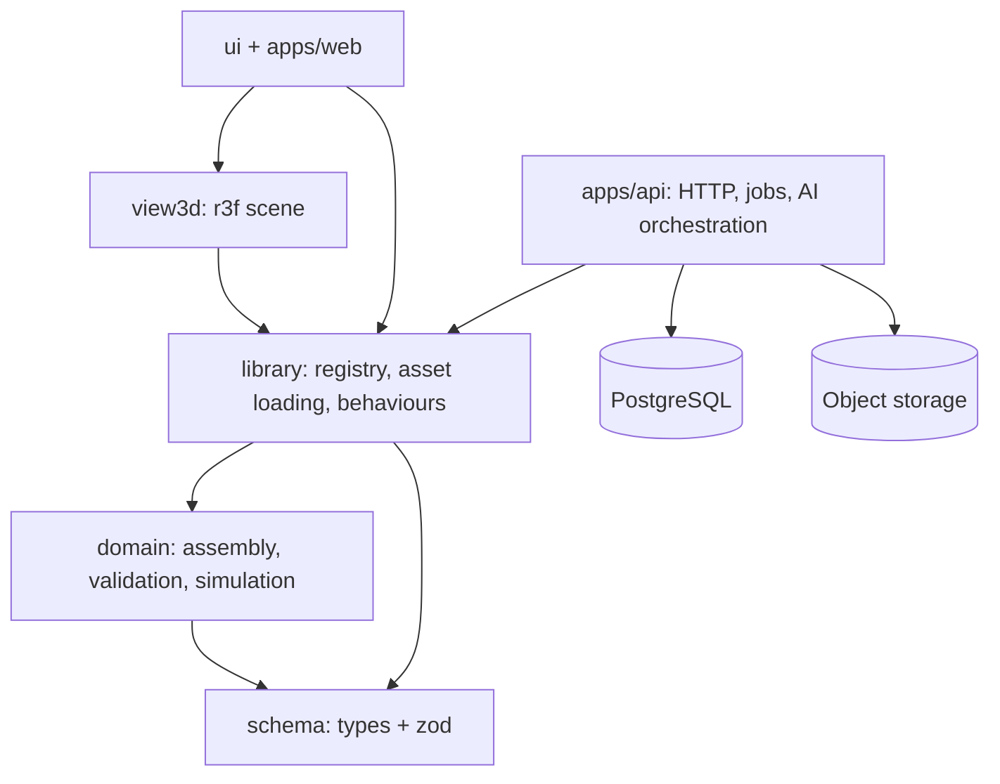
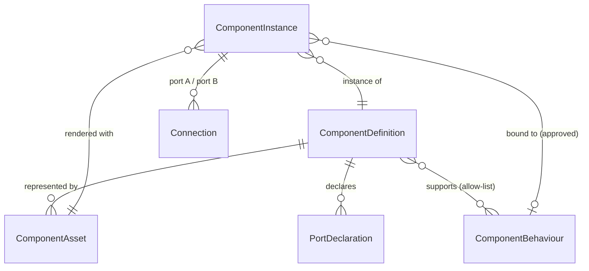
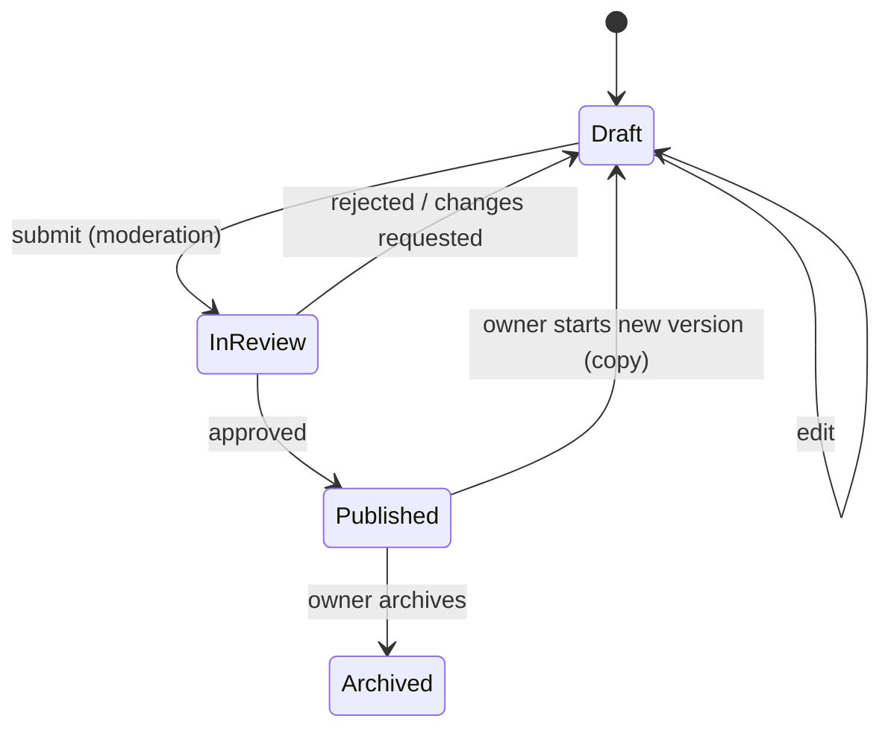
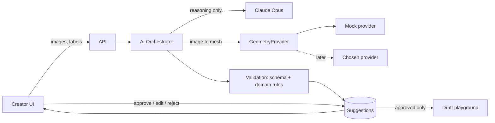

# Architecture

BuildMyMachine is one platform. Predefined machines and user-created playgrounds use the same component ecosystem, 3D workspace, assembly engine, validation and simulation architecture, and the same backend. There are no special code paths for platform-owned content.

## 1. Layers



- **Domain core** has no React, Three.js, network or file access. It is pure and deterministic, and it is where most tests live.
- **View layer** renders domain state and turns pointer input into domain commands. It holds no business rules.
- **API** owns persistence, authorisation, uploads, background jobs and AI orchestration.

## 2. The Four Component Concepts

These are separate concepts with separate schemas. Do not merge them.

| Concept | What it is | Owned by | Created by |
|---------|-----------|----------|-----------|
| **Component Definition** | Identity, function, properties, port declarations and compatibility rules of a reusable component type | Platform library, or a creator (scoped) | Platform authors, or creators with AI suggestions |
| **Component Asset** | The glTF/GLB visual model and metadata representing a definition. A definition may have several assets (for example, levels of detail). | Same owner as the definition | Hand-authored, or AI-generated (visual only) |
| **Component Behaviour** | A library-defined, approved, executable simulation behaviour (motor rotation, conveyor motion, sensor trigger, and so on), referenced by id | Platform only | Platform engineers only. Never generated by AI or users |
| **Component Instance** | A placed occurrence of a definition in an assembly or playground: transform, parent, connections, and an optional approved behaviour binding | The assembly or playground | Users (Free Assembly), scripts (Guided), or creators |



Rules:

1. A definition lists which behaviour ids it may support (`supportedBehaviours`). A behaviour binding on an instance must come from that list.
2. Assets carry no behaviour. An asset with no behaviour binding is visual only.
3. A behaviour binding is created only by an explicit, authorised action (platform content authoring, or a creator approving a mapping). It is checked on the server and again by the domain validator.
4. AI output can propose a mapping. It cannot create one. See section 6.

## 3. Ports and Connections

- A **Port** is declared on a definition: id, type (for example `bolt-mount`, `shaft-coupling`, `belt-mount`), gender or role, local transform, allowed mate types, and optional constraints (axis, rotation limits, snap tolerance).
- **Port types are content, not code.** They are open identifiers declared in `content/port-types.json` (id, description, compatibility pairs) and loaded into a port-type registry. They are not a TypeScript enum, so adding a machine that needs a new port type never changes core packages. Definitions and AI suggestions may reference only registered port types.
- A **Connection** links two instance ports. The assembly engine accepts it only if the port types are compatible and constraints hold.
- Port positions in a GLB come from `port_*` empty nodes (see `3d-asset-standards.md`) and are normalised into port declarations when a definition is registered. The definition is the source of truth after import.

## 4. Assembly Engine (shared)

- Holds the assembly hierarchy (instances, parent links, connections) as immutable, serialisable state.
- Exposes commands: add, remove, move, rotate, connect, disconnect, set binding. Each returns a new state or a typed validation error.
- Validation is separate from interaction: `validateConnection`, `validateAssembly`, and `checkStep` for guided mode.
- **Free Assembly** applies the engine with permissive rules (any valid compatible connection) and soft guidance.
- **Guided Assembly** applies the same engine with a **script**: ordered steps, each naming the instance to place, the target port and a completion predicate. It adds highlighting, hints and progress.
- Neither mode may keep a private copy of component data or its own validation.

## 5. PlaygroundDefinition and Versioning

One schema describes every playground.

```
PlaygroundDefinition
  id, ownerId (platform account for built-in content), slug, title, category
  version (integer), status: draft | published | archived, visibility
  componentRefs[]        definitions and assets used
  instances[]            Component Instances with transforms and connections
  guidedScript?          ordered steps with dependencies
  simulationProgram?     sequence/state machine over bound behaviours
  learningContent?       explanations by component and step
  provenance             human-authored | AI-assisted (with suggestion ids)
```



- A published version is immutable. Editing creates a new draft copy, and publishing it creates version N+1.
- A user's saved assembly references `(playgroundId, version)`, so published edits never break saved work. Where a newer version exists, the UI offers an upgrade.
- Platform machines (bottle-capping, electric motor) are `PlaygroundDefinition` records owned by the platform account and loaded through the same path as user content.

## 6. AI Service Boundary



- **Reasoning and geometry are separate.** Claude analyses images and proposes components, relationships, ports, fitments and order. A `GeometryProvider` produces meshes. Neither calls the other directly. The orchestrator coordinates them.
- Every AI output is stored as a **Suggestion** with three independent fields:
  - `aiConfidence`: a number the AI reports. Advisory only.
  - `validationStatus`: set by the system (`schemaValid`, `domainValid`, or `failed` with reasons). Examples of domain rules: referenced ports exist, the dependency graph has no cycles, units are sane.
  - `reviewStatus`: `proposed | accepted | edited | rejected`. Set only by a human creator.
- Confidence never changes `validationStatus` or `reviewStatus`. High confidence does not skip review.
- Only suggestions with `reviewStatus` accepted or edited, and with `validationStatus` valid, may be applied to a draft. Publishing re-validates everything.
- **Behaviour mapping is never automatic.** AI may include a *recommended* behaviour id in a suggestion. The creator must explicitly choose the mapping in a separate action. The server rejects any binding that is not on the definition's `supportedBehaviours` list or that has no recorded creator approval.
- AI-generated assets are marked `visualOnly: true` and pass the same asset validation as hand-made ones.

## 7. Simulation Architecture

- A deterministic fixed-timestep engine in `domain` runs a `simulationProgram` over instances that have approved behaviour bindings.
- Behaviours are pure state-transition functions registered in the `library` behaviour registry. See `simulation-standards.md`.
- The view layer reads simulation state and applies transforms. It never advances the simulation.

## 8. Data Flow Summary

1. Content (platform or creator) is stored as `PlaygroundDefinition` plus its definitions and assets.
2. The web app loads a playground version through the API, validates it with `schema`, resolves definitions and assets through `library`, and builds the assembly state in `domain`.
3. The 3D workspace renders the state. User actions become domain commands.
4. Simulation, guided scripts and saving all operate on the same state.

## 9. Cross-Cutting Concerns

- **Errors:** typed results in the domain, structured error responses in the API, plain-language messages in the UI.
- **Authorisation:** server-side on every request. Ownership checks for all creator and admin actions.
- **Observability:** structured logs without secrets or personal data. AI call logs record ids, sizes, latency and cost, not raw images.
- **Accessibility:** keyboard operation and text alternatives for key 3D interactions (see `engineering-principles.md`).
